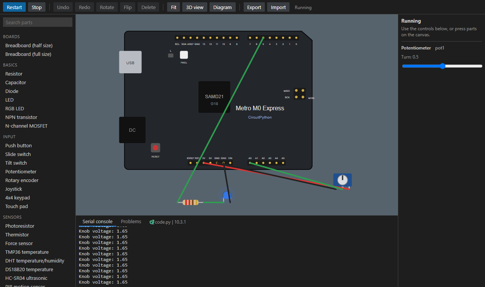
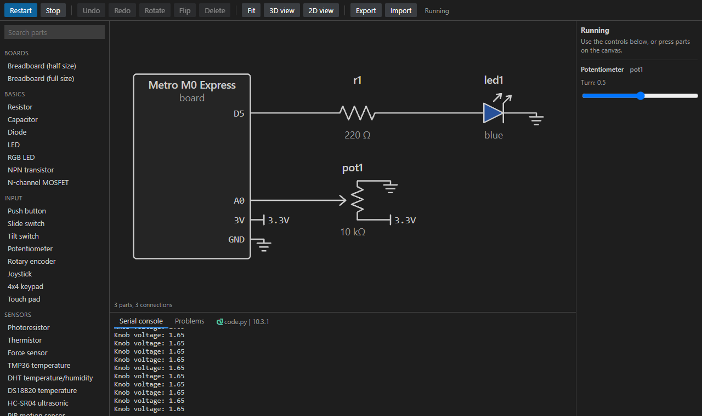
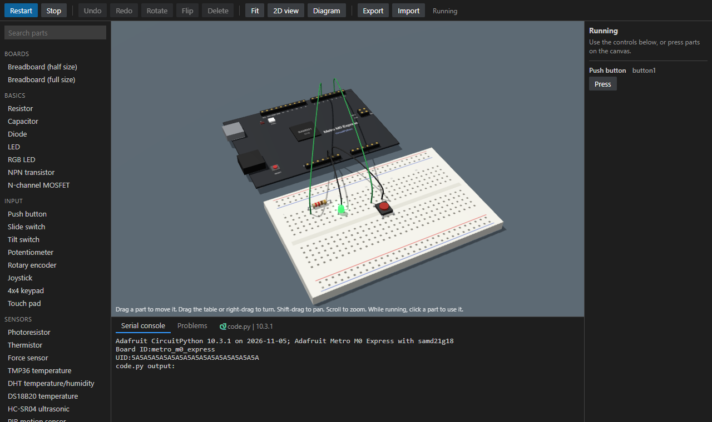

# Circuit Bench

Build circuits and test CircuitPython in VS Code, without a physical board. The simulator runs
real CircuitPython 10.3.1 compiled to WebAssembly, set up to behave like an Adafruit Metro M0
Express, so your `code.py` can move to a real board unchanged.

## Get started

1. Click the **Circuit Bench** icon (a circuit board) in the bar on the far left of VS Code. Its
   buttons do everything below, and every one is also in the Command Palette under
   **Circuit Bench**.
2. Click **New Project from Example**, or **Import Project Package** for a project someone gave you.
3. Open `code.py`, then click **Run My Code**, or the Run ▶ button at the top right of the editor.
   The circuit board button beside it opens the simulator without running anything.
4. Click **Set Up Autocomplete** for suggestions as you type. This needs the Python extension.

Each project is a folder holding `code.py`, your circuit in `circuit.json`, and a `lib` folder.
Opening `circuit.json` shows its [circuit diagram](#circuit-diagram). To move a project to another
computer or hand it in, see [Export and import](#export-and-import).

## Build a circuit

| To do this | Do this |
|---|---|
| Add a part | Click it in the list on the left |
| Move a part | Drag it. Pins that land in a breadboard hole connect automatically |
| Draw a wire | Click a pin, click empty space to add bends, then click another pin |
| Change a wire's path | Select it. Drag a dot to move a bend or add one, and double-click a bend to remove it |
| Rotate or flip | Select the part and press R or F. A group turns as a block |
| Select several things | Shift-drag a box around them, Ctrl-click or Shift-click each one, or press Ctrl+A |
| Move a selection | Drag any part of it, or use the arrow keys |
| Line parts up | Select two or more, then press Left, Center, Right, Top, Middle or Bottom |
| Copy, cut, paste | Ctrl+C, Ctrl+X, Ctrl+V. Ctrl+D duplicates |
| Delete | Select it and press Delete |
| Undo or redo | Ctrl+Z, and Ctrl+Y or Ctrl+Shift+Z |
| Pan or zoom | Drag the background, or use the mouse wheel |

Hover over a pin to see its name and everything connected to it. Select a part to give it a label,
which shows on the canvas, in the diagram and in the parts list. For a value that is not in a
resistor's list, type it, such as `4.7k` or `2M2`. Add a **Note** from the Tools list to leave text
on the canvas.

## Run it

Press **Run**, or F5 while the simulator has the focus. **Stop** is Shift+F5. While it runs, press
parts on the canvas, or use the controls on the right: Tab reaches them, and Space or Enter holds a
button down. The **Serial console** shows `print()` output: click it and press Ctrl+C to stop your
program and reach the REPL. Scroll up to read earlier output, and back to the end to follow it again.

Run saves your open project files first, so it always runs what you see. Like a real board, saving
`code.py`, or any file in the project such as one in `lib`, while your program runs restarts it with
the new code, and the console shows `Code saved, reloading.` Saving while it is stopped does not
start it.

If your program stops with an error, the line it stopped on gets a red squiggle, and the error is
listed in VS Code's **Problems** tab. When the error is inside a `.py` file in your project's `lib`
folder, that line is marked too, along with the line in your program that called it. In the console,
click `File "code.py", line 4` to open that line. The marks go away when you edit the file, or when
the program runs or reloads. If the error is `ImportError: no module named 'adafruit_hcsr04'` and
Circuit Bench has that library, the console offers to add it, and so does the light bulb on the
squiggle.

**Problems** warns about mistakes that would matter on a real board. A part being damaged smokes on
the canvas, and a part that is only wired wrong gets a warning sign. Hover over the part to read why,
or click the problem to select the part. Parts with no connection to the board or a battery turn grey,
because the simulation cannot reach them.

| Check | Limit |
|---|---|
| Board pins | 3.3V and 10mA each, and 500mA from the 3V or 5V supply |
| LEDs | 40mA, and 5V backwards. Any LED that is backwards gets a warning |
| Resistors | 0.25W |
| Capacitors of 1µF or more | Wired backwards, or over 16V |
| Diodes | 1A |
| NPN transistors | 600mA collector, 100mA base |
| Batteries | 2A |
| Powered parts | Their supply voltage, or `+` and `-` swapped |

**Problems** also compares `code.py` with the circuit, whether or not it is running. If the program
uses a board pin that nothing is wired to, it warns, for example "code.py line 3 uses board.D6, but
nothing is wired to D6. D5 is wired, but the code never uses it." Click the warning to open the
program at that line. `board.LED` (D13) and `board.NEOPIXEL` have parts on the board, so they need
no wires. `board.TX` and `board.RX` are D1 and D0, `board.I2C()` needs SCL and SDA, `board.SPI()`
needs SCK, and `board.UART()` needs D1 or D0. Comments and strings are skipped. The check reads the
program as text, so a pin chosen at run time, such as with `getattr(board, name)`, is not checked.

## Multimeter

Add a **Multimeter** from the Tools list and wire up its red and black probes. Click it while the
program runs to change what it measures, or use the buttons on the right.

| Mode | How to connect it | Good to know |
|---|---|---|
| Volts | Across two points | It reads a PWM pin as its average, as a real meter does |
| Amps | In series, so the current flows through it | Across a supply it blows its fuse until the next run |
| Ohms | Across an unpowered part | It shows `OL` for an open circuit and `LIVE` if the part is powered |

## Parts

Boards, breadboards, resistors, capacitors, diodes, LEDs, RGB LEDs, transistors, MOSFETs, buttons,
switches, potentiometers, rotary encoders, joysticks, keypads, touch pads, photoresistors,
thermistors, force sensors, TMP36, DHT11/22, DS18B20, HC-SR04, PIR, sound and water sensors, IR
receiver and remote, MPU-6050, MCP9808, DS3231, buzzers, servos, DC motors, steppers, relays,
NeoPixels, 7-segment displays, LED bars, 8x8 matrices, character LCDs, SSD1306 OLEDs, 74HC595,
L293D, batteries, multimeters and notes.

## Differences from a real board

- Python runs much faster than on a real M0, so slow code can look fine here.
- Timing is close, not exact. Short sleeps can run a few milliseconds long on Windows.
- Memory limits are an estimate, so a program near the limit may behave differently.
- Parts are simplified. Capacitors do nothing at DC, and the display contrast pin is ignored.
- USB keyboard, mouse and MIDI output is accepted, but nothing shows it yet.

## Export and import

Press **Export** in the builder or run **Circuit Bench: Export Project**, then choose what to save.

| Export | What you get |
|---|---|
| Project package | A `.circuitbench` file holding the program, circuit and libraries |
| Circuit picture | The canvas as PNG or SVG, including what is showing if a program is running |
| Circuit diagram | The schematic as PNG or SVG, on a white page |
| Parts list | A CSV file of what to gather, for a spreadsheet |

To open a project package, press **Import** or run **Circuit Bench: Import Project Package**, then
choose a folder. It creates a new project folder and opens it. A package only holds project files: it
cannot include VS Code settings or tasks, it cannot write outside the new folder, and nothing in it
runs until you press **Run**, which only runs it on the simulated board.

Packages saved as `.metrosim` by earlier versions still open.

## Circuit diagram

Press **Diagram** in the builder, run **Circuit Bench: Show Circuit Diagram**, or open
`circuit.json` to see the circuit as a schematic. It shows how parts are joined rather than where
they sit, so breadboards disappear and only the board pins in use are drawn. Power and ground are
marked at each pin instead of being wired across the page.

The diagram only shows the circuit, and it updates as you build. In the builder, press **2D view** to
go back to building. In the `circuit.json` tab, press **Edit circuit** to open the builder, or **Show
JSON** to see the file as text. Hover over a wire to light up everything joined to it. Wires that
cross without a dot are not connected.

Parts need no diagram symbol: each one is drawn as a labelled block. To draw a part with its own
symbol, add it to `SYMBOLS` in `webview/diagram-art.js`.

To work on the diagram outside VS Code, serve the `extension` folder over HTTP and open
`test/diagram-preview.html?example=dimmer`.

## 3D view

The 3D view button shows the circuit in 3D. Students wire in the 2D canvas, but they can pick up parts and move them in 3D: drag a part to move it, Ctrl-click to select several, and press R, F or Delete as in 2D. Moves snap to the grid and land in breadboard holes, and undo puts them back. While a program runs, clicking a part works as it does in 2D: press a button, flip a switch or change the multimeter's mode. Dragging the table, or the arrow keys, turns the view. Right-drag or Shift-drag pans it, as right-drag does on the 2D canvas. Smoke, warning signs, grey parts and notes only show on the 2D canvas. Close the view to free its memory.

Parts need no 3D model: each one gets a body from the largest shape in its 2D art, with that art on top. To model a part by hand, add it to `BUILDERS` in `webview/scene3d.js`.

three.js 0.186.1 is kept in `webview/vendor/three`, copied from the npm package's `build` folder with its licence. It loads the first time the view opens.

## Licence

MIT. The extension includes third-party software, listed in [THIRD_PARTY_NOTICES.md](THIRD_PARTY_NOTICES.md).
